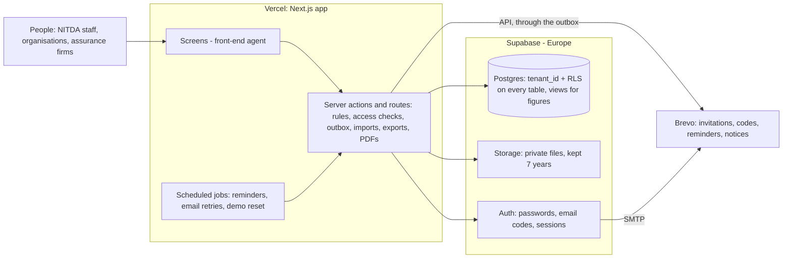
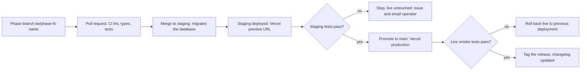

# SuperAtlas: Back-end requirements and implementation plan

20 Oct 2026 · Prepared for the SuperAtlas build (Claude Code)

## 1. How to use this document

This is the build contract for the SuperAtlas back end. It is written for Claude Code, the same agent that is building the screens in `Emmalex17/SuperAtlas`. One agent owns the whole application: screens, server code, database, email and deployment. It works through this document and the UI parity plan (`docs/PARITY_PROMPT.md`) together, so each area is finished end to end, from screen to database, before moving on.

The behaviour to reproduce is the approved clickable prototype (version 22). Every screen, label and journey in it is the specification for user-facing behaviour; this document specifies everything behind it.

**Golden rules for the agent**

1. Finish Step 0 (credentials) and Step 0.5 (repository check) before writing feature code. Stop and ask if either fails.
2. Never put a secret in code, in a commit, in a log or in this document. Read every secret from environment variables by the names given in section 2.
3. Every database change is a new, additive migration. Staging and live share one database, so a migration must never break the code currently live (no dropped or renamed columns in the same release that stops using them).
4. Every table that holds customer data carries `tenant_id` and has row-level security on. No exceptions.
5. Business rules run on the server (database functions or server code), never only in the browser.
6. Work phase by phase (section 15). A phase is done only when its acceptance tests pass on staging; then promote to live (section 16).
7. When the repository differs from this document, follow the repository and record the difference in `docs/RECONCILIATION.md`. Stop and ask only when a difference changes behaviour.
8. Anything listed in the later-phase register (section 19) is out of scope. Do not build it, but do not design anything that blocks it.
9. Keep the user-facing words from the prototype: plain British English, sentence case, "organisation", dates as 19 Oct 2026, no long dashes in user-facing text.

**Reading order:** sections 2 to 5 before starting; sections 6 to 14 as reference while building; section 15 is the work plan; sections 16 and 17 say how to ship and prove it.

**Glossary**

| Term | Meaning |
| --- | --- |
| Tenant | One regulator's private space. Live NITDA and NITDA (Demo) are two tenants. |
| Workspace | What a signed-in person sees: regulator, organisation or assurance firm. |
| Organisation | A supervised entity, for example a bank or a cloud provider. |
| Assurance firm (firm) | An independent assessor accredited by the regulator, for example Deloitte. |
| Series | A recurring programme, for example the ISR annual assessment. |
| Programme (cycle) | One year of a series, for example ISR 2026. |
| Case (engagement) | One organisation's assessment in one programme. |
| Finding | A gap raised in an assessment: OFI, OBS, MiNC or MaNC. |
| Return | A periodic data submission against a return template. |
| Enforcement case | A regulatory action against an organisation, from advisory to referral. |

## 2. Step 0: verify access before any code

The agent already has access to GitHub, Vercel, Supabase and Brevo from its front-end work. Step 0 therefore **verifies** that access instead of asking for it again: it runs the check in the last column for every item, reports a table of passed and failed items, and asks the operator only for what is missing or failing. Feature work starts only when every required item passes.

Secrets stay where they already live (Vercel environment variables for Production and Preview, GitHub Actions secrets, the local untracked `.env.local`). The agent adds missing ones there, never in a committed file, and keeps `.env.example` in the repository up to date with every name and an empty value.

| # | Name | What it is | How the agent verifies it | Required |
| --- | --- | --- | --- | --- |
| 1 | `BREVO_API_KEY` | Brevo v3 API key | `GET https://api.brevo.com/v3/account` returns 200; then sends a test email to the starter admin | Yes |
| 2 | `BREVO_SMTP_LOGIN`, `BREVO_SMTP_KEY` | Brevo SMTP credentials, host `smtp-relay.brevo.com`, port 587 | Set as Supabase Auth custom SMTP; trigger a password-reset email to the starter admin | Yes |
| 3 | `EMAIL_FROM_ADDRESS`, `EMAIL_FROM_NAME` | Verified sender, for example `no-reply@<domain>`, "SuperAtlas" | Brevo `GET /v3/senders` lists it as active; domain shows SPF and DKIM verified | Yes |
| 4 | `EMAIL_REPLY_TO` | Support address shown in email footers | Present and a valid address | Yes |
| 5 | `NEXT_PUBLIC_SUPABASE_URL`, `SUPABASE_PROJECT_REF` | Supabase project URL and reference (region: Europe) | Health request returns 200 | Yes |
| 6 | `NEXT_PUBLIC_SUPABASE_ANON_KEY` | Publishable key | A select on a public test view works and a select on a protected table returns nothing | Yes |
| 7 | `SUPABASE_SERVICE_ROLE_KEY` | Secret key, server only | Admin user list call returns 200. Never exposed to the browser. | Yes |
| 8 | `DATABASE_URL`, `DIRECT_URL` | Pooled and direct Postgres connection strings | `select 1` on both | Yes |
| 9 | `SUPABASE_ACCESS_TOKEN` | Personal access token for the Supabase CLI | `supabase projects list` shows the project | Yes |
| 10 | `VERCEL_TOKEN`, `VERCEL_ORG_ID`, `VERCEL_PROJECT_ID` | Vercel access | `vercel project ls` shows the project | Yes |
| 11 | `APP_URL`, `STAGING_URL` | Live domain and the staging branch URL | Both return HTTP 200 | Yes |
| 12 | GitHub access | Collaborator access or fine-grained token: contents, pull requests, actions, workflows (read and write) on `Emmalex17/SuperAtlas` | Push a throwaway branch, open and close a draft pull request, delete the branch | Yes |
| 13 | Branch names | `main` = live, `staging` = staging | Both branches exist; Vercel builds `staging` as a preview with a fixed URL | Yes |
| 14 | `STARTER_ADMIN_EMAIL` | `emmanuel.adedeji@opexconsult.co.uk`, first admin of live NITDA | Test email from item 1 arrives (operator confirms) | Yes |
| 15 | `CRON_SECRET` | Random string that protects scheduled job routes | Agent generates it (32+ random bytes) | Agent creates |
| 16 | `DEMO_PASSWORD_*` | One strong fixed password per demo account (section 14) | Agent generates them (20+ characters, mixed) and stores them as secrets | Agent creates |
| 17 | `AI_PROVIDER` | `demo` now; `anthropic` later | Set to `demo` | Agent sets |

**Brevo domain.** If SPF and DKIM are not yet verified, the agent stops and tells the operator which DNS records Brevo shows, because email cannot be tested until they are in place.

**Supabase Auth settings the agent applies in Step 0:** custom SMTP through Brevo (item 2); email OTP length 6 and expiry 10 minutes; email confirmations on; site URL = `APP_URL`; redirect URLs = `APP_URL/**` and `STAGING_URL/**`; public sign-ups **off** (invitation only).

**Report back.** End Step 0 with a table of all 17 items, each marked passed, created or failed, and what is needed for any failure.

## 3. Step 0.5: repository check and how back end and screens are built together

The app is Next.js with TypeScript on Vercel, and the agent already knows its structure. Step 0.5 writes that knowledge down so the back end fits it, then sets the order in which back end and screens are built.

**Write `docs/RECONCILIATION.md` with:**

1. Next.js version, App Router or Pages Router, package manager, Node version.
2. Current Supabase usage: client helpers (`@supabase/ssr` or older), existing tables, migrations and auth code.
3. Existing routes mapped to the prototype screen IDs (reuse `docs/prototype/PARITY_AUDIT.md` if the parity audit has run).
4. Environment variables already in use.
5. Lint, type-check, test and CI commands.
6. Every difference from the layout below and the decision taken ("document says `src/server`, repo uses `lib/server`: using `lib/server`").

**Assumed layout (adapt names to the repo):**

| Path | Holds |
| --- | --- |
| `supabase/migrations/` | SQL migrations, numbered by timestamp |
| `supabase/seed/` | Live NITDA bootstrap and demo seed scripts |
| `src/server/` | Server actions, services, business rules, email, storage, imports, exports, AI provider |
| `src/app/api/` | Route handlers: cron jobs, file downloads, uploads, webhooks, health |
| `src/lib/supabase/` | Server, browser and admin Supabase clients |
| `src/lib/data/` | The screens' data layer: one interface per area, with a mock adapter (prototype data) and a live adapter (server actions) |
| `src/contracts/` | Generated database types (`database.ts`) and action input and output schemas (`actions.ts`) |
| `src/app/`, `src/components/` | Screens and components |
| `src/emails/` | Email templates |
| `tests/` | Unit, access, integration and end-to-end tests |
| `docs/` | `BACKEND_SPEC.md`, `PARITY_PROMPT.md`, `RECONCILIATION.md`, `CHANGELOG.md`, `prototype/` |

**Order of work: one area at a time, end to end**

For each back-end phase in section 15, the agent:

1. Builds the back end for the phase (migrations, RLS, actions, emails, seed) and its tests.
2. Switches that area's screens from the mock adapter to the live adapter in `src/lib/data/`, so the screens now read and write real data.
3. Re-runs the UI parity checks for the screens in that area (`tools/parity/extract.cjs`, screenshots, journeys). The screens must still match the prototype exactly with real data.
4. Ships the phase through the pipeline in section 16.

| Back-end phase | UI parity phases it brings to life |
| --- | --- |
| 1 Foundations, email, sign-in | P1 Public site and sign-in (sign-in, code, invitation, reset), app shell, account, notifications |
| 2 Organisations, firms, invitations | P2 Regulator settings and team, P3 Organisations and assurance firms |
| 3 Library, scoring, AI | P4 Requirements library, scoring and finding-class settings |
| 4 Programmes and engagements | P5 Programmes and engagements |
| 5 Answering and assessment | P6 Answering and assessment |
| 6 Review, publishing, findings, ratings | P7 Review, publishing and findings, firm performance |
| 7 Data returns | P8 Data returns |
| 8 Compliance, analytics, enforcement | P9 Compliance and enforcement, programme analytics, regulator dashboard |
| 9 Exports, search, tasks, full demo | P10 Dashboards, search, task panel, exports, demo access |

If the UI parity work for an area is not finished when its back-end phase starts, finish the screens first: a back end wired to the wrong screens is wasted work.

**Working rules**

- **Contract.** After every migration, regenerate `src/contracts/database.ts`. Every server action has its Zod input and output schema in `src/contracts/actions.ts`, and screens import types only from there.
- **Branches.** For each phase: pull `staging`, branch `phase-N-<slug>`, commit in small steps, open a pull request into `staging`, merge when CI is green, then section 16 takes over.
- **Changelog.** Each phase adds an entry to `docs/CHANGELOG.md`: what was built, actions added, migrations, screens switched to live data, parity results.

## 4. Scope and agreed decisions

The pilot serves one regulator, NITDA, in two separate tenants: live NITDA, which starts empty, and NITDA (Demo), which holds all demonstration data and resets every night.

| Area | Decision |
| --- | --- |
| Tenancy | Built for many regulators from day one (`tenant_id` everywhere). Only NITDA and NITDA (Demo) exist. Created by script; no platform-admin portal yet. |
| Live NITDA | Starts empty. Starter admin: `emmanuel.adedeji@opexconsult.co.uk`, who sets his password, name and role on first sign-in and can later hand over to NITDA staff. |
| Demo | Separate tenant "NITDA (Demo)". Demo organisations carry "(Demo)" in their names, for example "Zenith Bank (Demo)". A "Demo data" banner shows on every screen. Reset every night at 02:00 WAT. |
| Sign-in | Email and password, then a 6-digit code sent by email through Brevo. Demo accounts use fixed passwords and skip the code. No single sign-on. |
| Who joins how | Invitation only. NITDA invites organisations and assurance firms; the first person to accept becomes that organisation's or firm's admin and can invite colleagues. No self-registration. |
| One person, one workspace | An email belongs to exactly one membership: one regulator, one organisation or one firm. |
| Visibility | A regulator sees only its own tenant. An organisation sees only itself. A firm sees only the organisations it is engaged to assess. |
| Email | All email through Brevo, including Supabase Auth email (codes, password reset, email change). |
| Files | Private Supabase Storage, 25 MB per file, PDF, Office files and images, kept 7 years, downloads through links that expire after 10 minutes. |
| Imports | Downloadable templates in CSV and Excel. Pilot imports: programme questions, requirements, organisation invites, firm invites. |
| Exports | Scorecards and board pack as server-generated PDFs; CSV exports. |
| Penalties | Recorded only (amount, payment reference, date paid, proof of payment). No payment gateway. |
| AI | Behind a provider switch, `demo` for the pilot (section 13). AI never suggests answers to organisations. |
| Hosting | Vercel for the app; one Supabase project in Europe shared by staging and live. |
| Deployment | Fully automatic: staging first, automated checks, then live, with no manual approval. |

**In scope for the pilot** (built in phases, section 15):

- Foundations: tenants, memberships, roles, access rules, audit log, notifications.
- Sign-in, email codes, invitations, colleagues, profile, email and password changes, password reset.
- Organisations and assurance firms: profiles, categories, accreditations, people, advisory clients (independence).
- Requirements library and scoring schemes, with requirement import.
- Programmes and cycles, question sets with question import, scope, firm assignment, engagements.
- Answering with evidence, information requests, interviews, assessment outcomes, findings, preview, report sign-off, review and publishing.
- Findings and remediation, extensions, fix verification.
- Data returns: templates, filings, queries, acceptance, reminders.
- Compliance status, analytics, watchlist and enforcement.
- Firm performance and ratings, scorecards, CSV exports, board pack.
- Search, task panel counts, notifications by email and in the app.
- Demo tenant seed and nightly reset.

**Out of scope for the pilot:** everything in the later-phase register (section 19).

## 5. Architecture and data flow

One Next.js application on Vercel serves the screens and the server logic. Supabase provides the database, sign-in, file storage and scheduled jobs. Brevo sends every email.



Screens never write to the database directly: every change goes through a server action, which checks access, applies the rule and queues any email.

| Component | Technology | Responsibility |
| --- | --- | --- |
| Web app | Next.js (App Router) + TypeScript on Vercel | Screens, server actions and route handlers, all built by the same agent |
| Server logic | Next.js server actions in `src/server`, Zod-validated | All writes, all business rules, all email sending, imports and exports |
| Database | Supabase Postgres 15+ with row-level security | All data, with `tenant_id` on every business table; SQL views and functions for calculated figures |
| Sign-in | Supabase Auth (email + password, email OTP) | Identity, sessions, password reset, email change; custom SMTP through Brevo |
| Files | Supabase Storage, private buckets | Evidence, report PDFs, imports, proof of payment, logos |
| Email | Brevo transactional API (`POST /v3/smtp/email`) | All app email; Supabase Auth email via Brevo SMTP |
| Scheduled jobs | Vercel Cron calling `src/app/api/cron/*` with `CRON_SECRET` | Daily reminders, nightly demo reset, status recalculation, email retries |
| PDFs | Server-side rendering with `@react-pdf/renderer` | Scorecards, board pack, assessment reports |
| Spreadsheets | `exceljs` (Excel) and `papaparse` (CSV) | Import templates, import parsing, CSV exports |

**How a typical write flows** (an organisation submits its assessment):

1. The screen calls the server action `submitCase({caseId})`.
2. The action reads the session with the server Supabase client, checks the caller's membership and role, and validates input with Zod.
3. It checks the business rule (all required questions answered, evidence attached where required) and returns a field-level error list if it fails.
4. In one database transaction it updates `cases.stage`, writes `case_events`, writes `audit_log`, and inserts `notifications` for the firm's team and NITDA.
5. After the transaction commits, it queues emails in `email_outbox`. A sender sends them through Brevo right away; failures are retried by the cron job.
6. It returns the updated case. The screen re-renders from the response.

**Read rules.** Screens read through server components or server actions using the caller's session, so row-level security applies to every read. Calculated figures (compliance status, watchlist, analytics) come from SQL views or functions so that the numbers on dashboards always match the lists behind them.

**Service role.** The secret service-role key is used only by cron jobs, seed scripts, the email sender and invitation acceptance. It is never sent to the browser, and every service-role call is written to `audit_log` with `actor = system`.

**Time.** All timestamps are stored in UTC (`timestamptz`); dates shown in Africa/Lagos time. The prototype's fixed date (19 Oct 2026) is replaced by the real date everywhere. Demo data uses dates relative to the reset day (section 14).

## 6. Tenancy, identity, roles and access rules

Every person has one Supabase Auth user and exactly one active membership, and that membership decides what they can see and do. Row-level security enforces it in the database, and server actions check it again before every write.

**Identity model**

- `auth.users`: Supabase identity (email, password hash, email confirmed).
- `profiles` (1:1 with `auth.users`): full name, initials, job title, phone, avatar, `is_demo`, last sign-in.
- `memberships`: `user_id`, `tenant_id`, `workspace` (`regulator`, `organisation` or `firm`), `org_id` or `firm_id` (exactly one, matching the workspace), `role`, `status` (`invited`, `active`, `suspended`, `removed`). Unique active membership per user.
- `tenants`: `id`, `slug` (`nitda`, `nitda-demo`), `name`, `short_name`, `is_demo`, branding (colours, logo path), settings JSON.

**Roles**

| Workspace | Role | Can |
| --- | --- | --- |
| Regulator | Admin | Everything, including settings, team, branding, scoring schemes |
| Regulator | Supervisor | Invite organisations and firms, approve classification changes, accredit firms, review and publish reports, enforcement |
| Regulator | Reviewer | Review reports and returns assigned to them; raise queries |
| Regulator | Viewer | Read-only dashboards and records |
| Organisation | Admin | Everything for their organisation, including colleagues and profile |
| Organisation | Contributor | Answer questions, upload evidence, file returns, plan fixes |
| Organisation | Viewer | Read-only |
| Firm | Admin | Everything for their firm, including people, advisory clients, accepting engagements |
| Firm | Lead auditor | Lead engagements, record outcomes, sign off reports |
| Firm | Assessor | Work on assigned engagements: requests, interviews, outcomes, findings |

The regulator permission matrix from the prototype (Settings, Team and roles) is stored in `role_permissions` so the Admin can change it. Permission keys: `orgs.invite`, `orgs.classify`, `firms.accredit`, `library.edit`, `reviews.review`, `reports.publish`, `settings.manage`, `dashboards.view`, `enforcement.manage`, `returns.manage`, `programmes.manage`.

**Row-level security, by table family**

| Data | Regulator members | Organisation members | Firm members |
| --- | --- | --- | --- |
| Tenant settings, library, schemes, categories | Read; write with permission | Read published library and their own category | Read published library |
| Organisations | All in their tenant | Their own row | Rows of organisations they have an engagement with |
| Firms | All in their tenant | Firms engaged with them (name and accreditation only) | Their own row |
| Programmes | All | Programmes their organisation is in scope for | Programmes they have engagements in |
| Cases and everything under them (answers, evidence, outcomes, findings, requests, interviews, reports) | All | Their own cases; outcomes and findings only once shared in preview or published | Cases assigned to their firm |
| Returns and filings | All | Their own filings | None |
| Enforcement cases | All | Their own cases, only once a notice is issued | None |
| Ratings | All, with organisation names | Their own ratings | Their own ratings, organisation name hidden (a view without `org_id`) |
| Audit log | Admin: all in tenant | Admin: their organisation's entries | Admin: their firm's entries |
| Notifications | Own | Own | Own |

**Implementation**

- Helper SQL functions with `security definer` and a fixed `search_path`: `current_membership()`, `current_tenant_id()`, `is_regulator(perm text)`, `is_org_member(org uuid)`, `is_firm_member(firm uuid)`, `firm_can_see_org(org uuid)`.
- Every policy starts with `tenant_id = current_tenant_id()`.
- Demo and live are just two tenants: no policy may let a user read across tenants. A test proves that a NITDA (Demo) user reads zero rows from live NITDA in every table.
- Storage buckets use the same rule: object paths start with `<tenant_id>/`, and storage policies check membership against the record the file belongs to.

## 7. Sign-in, invitations and profile changes

People join only by invitation, sign in with email and password plus a 6-digit email code, and land in the one workspace their membership allows. Demo accounts skip the code.

### 7.1 Sign-in

1. The person enters email and password (`signIn`). Wrong details return one generic message ("Email or password is not right"), never which one was wrong.
2. After 5 failed attempts in 15 minutes the account is locked for 15 minutes; the screen says when to try again (prototype screen exists).
3. If the password is right and the account is not a demo account, the server asks Supabase to send a 6-digit email code (`signInWithOtp` with `shouldCreateUser: false`) and shows the code screen. The code expires in 10 minutes; "Send a new code" is allowed once every 60 seconds, at most 5 times an hour.
4. When the code is right (`verifyOtp`), the session starts. The server reads the membership and sends the person to their workspace: regulator `/dashboard`, organisation `/org/dashboard`, firm `/firm/dashboard`. No workspace switcher.
5. Sessions end after 15 minutes of inactivity with a 60-second warning (prototype behaviour) and after 12 hours in any case.
6. A suspended or removed membership cannot sign in: "Your access has been removed. Contact your administrator."

**Demo accounts** (`profiles.is_demo = true`, in the demo tenant only) sign in with password alone. They cannot change their email or password; the profile screen shows those fields as read-only with the note "Demo account: email and password are fixed."

### 7.2 Invitations

| Who invites | Whom | Lands as |
| --- | --- | --- |
| Regulator (permission `orgs.invite`) | An organisation: legal name, category, tier, contact name, contact email | Organisation Admin |
| Regulator (permission `firms.accredit`) | An assurance firm: name, accreditation types and dates, contact name, contact email | Firm Admin |
| Regulator Admin | A colleague at the regulator, with a role | That role |
| Organisation Admin | A colleague, with a role | Organisation Contributor or Viewer (or Admin) |
| Firm Admin | A colleague: role, credentials, credential expiry | Lead auditor or Assessor (or Admin) |

**Flow**

1. The inviter submits the invite (single, or a bulk import, section 12). The server creates the organisation or firm record if new (status `invited`), an `invitations` row with a random 32-byte token (stored only as a SHA-256 hash), expiry 7 days, and the intended role.
2. Brevo sends the invitation email (template `invite_org`, `invite_firm` or `invite_colleague`) with the link `APP_URL/accept/<token>`.
3. The accept page shows who invited them and to what. The person sets their name and a password (minimum 12 characters, checked against common passwords).
4. The server (service role) creates the Auth user with the email confirmed, creates the profile and an active membership, marks the invitation accepted, sets the organisation or firm to `active`, writes the audit log and notifies the inviter.
5. The person signs in normally (with email code). An organisation or firm Admin is taken to the welcome checklist to complete the profile (prototype onboarding screens).

**Rules**

- An email that already has an active membership anywhere cannot be invited again: "This email already has a SuperAtlas account."
- Pending invites can be resent (new token, old one void) or cancelled. Expired invites show as "Expired" with Resend.
- Organisations are trusted once their first user accepts. There is no "Pending verification" step in the pilot (later phase).

### 7.3 Starter admin for live NITDA

The bootstrap script (section 14.1) creates live NITDA and invites `STARTER_ADMIN_EMAIL` as Regulator Admin. He accepts through the normal invitation email, sets his password, name and job title, and signs in with the email code. From the team page he can invite NITDA staff, change roles and later remove himself once another Admin exists (the last Admin cannot be removed).

### 7.4 Profile, email and password changes

- **Profile:** name, job title and phone, editable at any time.
- **Password change:** current password required; new password at least 12 characters; all other sessions signed out; confirmation email sent.
- **Email change:** Supabase `updateUser({email})` with secure email change, so codes go to both the old and the new address. The change applies only after confirmation, and the audit log records old and new.
- **Forgotten password:** "Forgot password" sends a reset link through Brevo (Supabase recovery, link valid for 1 hour). The reply never reveals whether the email exists.

### 7.5 Removed from the sign-in screen for the pilot

Comment out (do not delete) the "Register your organisation" link and the route behind it, and the firm "Apply for accreditation" entry points. Both are listed in section 19.

## 8. Email through Brevo

Brevo is the first thing built (phase 1), because sign-in codes, invitations and password resets all depend on it. Every app email goes through one outbox, so nothing is lost when Brevo is slow or down.

**Two paths**

| Path | Used for | Set up |
| --- | --- | --- |
| Brevo SMTP from Supabase Auth | Sign-in codes, password reset, email-change confirmation | Supabase Auth, custom SMTP: host `smtp-relay.brevo.com`, port 587, `BREVO_SMTP_LOGIN`, `BREVO_SMTP_KEY`, sender `EMAIL_FROM_*`. Edit the Supabase email templates to the SuperAtlas wording and branding. |
| Brevo API from the app | Everything else | `src/server/email/send.ts` calls `POST https://api.brevo.com/v3/smtp/email` with header `api-key: BREVO_API_KEY` |

**Outbox.** Server actions never call Brevo directly. They insert into `email_outbox` (`tenant_id`, `to_email`, `to_name`, `template`, `params` JSON, `status` = `queued`, `attempts`, `next_attempt_at`, `brevo_message_id`, `last_error`). After the transaction commits, the action calls the sender for those rows. The cron job `/api/cron/email` runs every 5 minutes and retries failures at 1, 5, 30 and 120 minutes, then marks them `failed`. A failed invite shows "Email not delivered" with Resend on the inviter's screen.

**Templates** live in `src/emails/` as React Email components rendered to HTML on the server, with a plain-text version. Each has the tenant name and logo, one clear button, and a footer with `EMAIL_REPLY_TO`. Demo-tenant emails add "Demo" to the subject.

**Email events in the pilot**

| Template | Sent to | When |
| --- | --- | --- |
| `invite_org` | Organisation contact | Regulator invites an organisation |
| `invite_firm` | Firm contact | Regulator invites a firm |
| `invite_colleague` | Invitee | Any admin invites a colleague |
| `invite_accepted` | Inviter | Invitation accepted |
| `password_changed` | User | Password changed |
| `programme_launched` | Organisation admins in scope | Programme opens for answers |
| `engagement_assigned` | Firm admins and lead | Firm assigned to an organisation |
| `engagement_response` | Regulator supervisors; organisation admins | Firm accepts or declines |
| `case_submitted` | Firm team; regulator | Organisation submits answers |
| `info_request` | Organisation contributors | Firm asks for more information |
| `info_reply` | Firm team | Organisation replies |
| `interview_invite` | Organisation attendees | Firm schedules an interview |
| `preview_shared` | Organisation admins | Firm shares the outcome preview |
| `report_submitted` | Regulator reviewers | Firm submits the signed report |
| `report_returned` | Firm lead | Regulator returns the report |
| `report_published` | Organisation admins; firm lead | Regulator publishes |
| `finding_raised` | Organisation admins | Report published with findings to fix |
| `fix_submitted` | Firm lead | Organisation submits proof of a fix |
| `fix_verified` / `fix_rejected` | Organisation admins; regulator | Firm verifies or rejects a fix |
| `extension_decision` | Organisation admins | Regulator decides an extension request |
| `return_due` | Organisation admins | 7 days and 1 day before a return is due (cron) |
| `return_overdue` | Organisation admins; regulator | Day after the due date (cron) |
| `return_queried` | Organisation admins | Regulator raises a query |
| `return_accepted` | Organisation admins | Regulator accepts a filing |
| `fix_due` / `fix_overdue` | Organisation admins | 7 days before and the day after a fix is due (cron) |
| `notice_issued` | Organisation admins | Regulator issues an enforcement notice |
| `notice_response` | Regulator supervisors | Organisation responds or uploads proof |
| `daily_digest` | Regulator users who choose it | 07:00 WAT summary of tasks (optional per user) |

**Rules**

- Every email also creates an in-app notification. Each user can turn off non-essential emails in their notification settings; invitations, codes, password and security emails cannot be turned off.
- No personal data beyond names goes into subjects. Email bodies link to the record; they never contain evidence or scores.
- Brevo webhooks for bounces and complaints (`/api/webhooks/brevo`, verified by a shared secret) mark the address in `email_suppressions`; later sends to it are skipped and shown as "Email not delivered".
- In tests and local runs, `EMAIL_TRANSPORT=log` writes emails to the console and the outbox instead of sending.

## 9. Data model

About 45 tables in the `public` schema. Every business table has `id uuid primary key default gen_random_uuid()`, `tenant_id uuid not null references tenants`, `created_at`, `updated_at` (trigger), and `created_by uuid` where a person creates it. Status columns are Postgres enums or text with check constraints, using the exact words below, which are the words on screen.

### 9.1 Platform and people

| Table | Key columns |
| --- | --- |
| `tenants` | slug, name, short\_name, legal\_name, is\_demo, mandate, sectors\[\], email, phone, address, branding JSON (colours, logo\_path, sign-in message), settings JSON |
| `profiles` | user\_id (PK, = auth.users.id), full\_name, initials, job\_title, phone, avatar\_path, is\_demo, notification\_prefs JSON, last\_seen\_at |
| `memberships` | user\_id, workspace, org\_id, firm\_id, role, status, invited\_by, joined\_at; unique active per user |
| `invitations` | email, workspace, org\_id, firm\_id, role, token\_hash, expires\_at, status (pending, accepted, expired, cancelled), invited\_by, accepted\_at, payload JSON (name, title, credentials) |
| `role_permissions` | role, permission, allowed |
| `notifications` | user\_id, kind (Approvals, Updates, Reminders), icon, tone, title, body, link\_route, link\_arg, read\_at |
| `email_outbox`, `email_suppressions` | section 8 |
| `audit_log` | actor\_user\_id or `system`, actor\_name, workspace, action, record\_type, record\_id, record\_label, detail JSON, ip, user\_agent, at. Insert-only: no update or delete grants. |
| `saved_views` | user\_id, screen, name, filters JSON (later phase; table created now) |

### 9.2 Organisations and firms

| Table | Key columns |
| --- | --- |
| `sector_groups`, `org_types`, `org_tiers` | The category tree: group (Banking, Payments, Digital economy) > type (Commercial bank) with plural name > tiers (National, Regional) |
| `organisations` | legal\_name, short\_name, initials, colour, rc\_number, website, head\_office, sector\_group\_id, type\_id, tier\_id, status (invited, active, suspended), compliance\_contact\_email, tags\[\], joined\_at, onboarding JSON, logo\_path |
| `org_officers` | org\_id, name, role (for example Chief compliance officer), email, phone |
| `org_groups` | parent and subsidiary links between organisations |
| `classification_requests` | org\_id, from\_type, from\_tier, to\_type, to\_tier, reason, status (Pending, Approved, Declined), decided\_by, decided\_at |
| `firms` | name, initials, colour, website, city, status (invited, Accredited, Renewal due, Suspended), types\[\], since, onboarding JSON, logo\_path |
| `firm_accreditations` | firm\_id, type (Audit and assurance, Cybersecurity assessor, Data protection compliance organisation), reference, valid\_from, valid\_to, status |
| `firm_people` | firm\_id, user\_id (nullable until they join), name, role, title, credentials, credential\_expiry, status |
| `firm_advisory_clients` | firm\_id, org\_id or org\_name, service, from, to (used for independence checks) |
| `tenant_rules` | firm renewal months (12), grace days (30), conflict months (24), compliance benchmark per series (default 70), watch\_overdue\_days (blank = off), watch\_cycles\_running (2), watch\_late\_runs (3) |

### 9.3 Library and scoring

| Table | Key columns |
| --- | --- |
| `regulations` | reference, name, category, version, effective\_date, status (Draft, Published, Retired), applies\_to (type ids), description, source\_file\_path |
| `regulation_sections` | regulation\_id, number, name, sort |
| `requirements` | section\_id, ref (unique per regulation, for example ISR-4.1), title, text, guidance, weight (High, Medium, Low), evidence\_hint, sort |
| `requirement_questions` | requirement\_id, text, answer\_type (yes\_no, yes\_no\_na, text, date, number, choice, file), choices\[\], comment\_allowed, evidence\_required, interview, sort |
| `scoring_schemes` | name, kind, is\_default, levels JSON `[{label, points, tone}]`, bands JSON `[{label, min}]` |
| `finding_classes` | code (MaNC, MiNC, OBS, OFI), name, description, fix\_days (30, 60, 90, 0), tone, sort |
| `ai_suggestions` | section 13 |

### 9.4 Programmes and assessments

| Table | Key columns |
| --- | --- |
| `series` | name, regulation\_id, frequency |
| `programmes` | series\_id, cycle (year), name, regulation\_id, scheme\_id, status (Draft, Scheduled, Open, Closed), opens\_at, closes\_at, org\_type\_ids\[\], description, firm\_mode (regulator assigns, organisation chooses), preview\_enabled, publisher\_role, reminder\_days\[\], escalate\_after\_days, locked\_at, question\_set\_version |
| `programme_sections`, `programme_requirements`, `programme_questions` | The programme's own copy of the question set (snapshot from the library at launch, editable before opening; source\_requirement\_id kept) |
| `programme_scope` | programme\_id, org\_id, added\_by, reason |
| `cases` | programme\_id, org\_id, firm\_id, firm\_status (Requested, Assigned, Accepted, Declined, Approved), lead\_person\_id, team person ids\[\], stage (see section 10.1), due\_at, submitted\_at, report\_submitted\_at, approved\_at, published\_at, score, band, reviewer\_id, opened\_by\_org\_at, report\_days |
| `case_events` | case\_id, from\_stage, to\_stage, by, at, note |
| `answers` | case\_id, question\_id, value JSON, comment, answered\_by, answered\_at |
| `evidence_files` | org\_id, case\_id (nullable for the evidence library), storage\_path, file\_name, mime, size\_bytes, sha256, uploaded\_by, retained\_until (uploaded + 7 years) |
| `answer_evidence` | answer\_id, evidence\_file\_id |
| `info_requests` | case\_id, requirement\_id, asked\_by, text, status (Open, Answered, Closed), due\_at; `info_request_messages` for the thread |
| `interviews` | case\_id, requirement\_ids\[\], scheduled\_at, duration\_min, attendees JSON, location or link, status, notes |
| `outcomes` | case\_id, requirement\_id, level\_label, note, recorded\_by, recorded\_at, override JSON (regulator changed it: from, to, reason, by) |
| `findings` | case\_id, org\_id, requirement\_id, ref, class\_code, title, detail, due\_at, status (see 10.4), raised\_by |
| `finding_updates` | finding\_id, kind (plan, progress, proof, verify, reject, extension\_request, extension\_decision, close), text, file ids\[\], by, at, extension\_date, decision |
| `preview_comments` | case\_id, requirement\_id, text, by, at |
| `reports` | case\_id, version, pdf\_path, signed\_by, declaration\_accepted\_at, submitted\_at, review\_note, status |
| `ratings` | firm\_id, org\_id, case\_id, stars 1 to 5, comment, created\_at; unique per case and organisation |

### 9.5 Data returns

| Table | Key columns |
| --- | --- |
| `return_templates` | code, name, frequency (Monthly, Quarterly, Annual), org\_type\_ids\[\], due\_days after period end, grace\_days, status (Draft, Active, Retired), version, description, reminder\_days\[\] |
| `return_fields` | template\_id, key, label, type (number, currency, percent, text, date, choice), unit, required, min, max, lte\_field\_key (must be at most another field), help, sort |
| `filings` | template\_id, template\_version, org\_id, period\_label (Q3 2026), period\_key (2026-Q3), due\_at, status (Not started, Draft, Submitted, Resubmitted, Queried, Accepted), submitted\_at, accepted\_at, late\_by\_days, source (online, spreadsheet) |
| `filing_values` | filing\_id, field\_key, value |
| `filing_queries` | filing\_id, field\_key, text, raised\_by, status, reply, replied\_at |

### 9.6 Compliance and enforcement

| Table | Key columns |
| --- | --- |
| `action_types` | key (advisory, warning, directive, penalty, restrict, referral), name, description, response\_days, has\_penalty, level 1 to 6 |
| `enforcement_cases` | ref (ENF-2026-001), org\_id, action\_type\_key, status (Draft, Awaiting sign-off, Notice issued, Response received, Awaiting payment, Escalated, Closed), reason, notice\_text, opened\_by, approver\_id, issued\_at, respond\_by, decision, penalty\_amount\_ngn, payment\_reference, paid\_at, closed\_at, escalated\_from\_id |
| `enforcement_evidence` | case\_id, kind (finding, result, filing, file), record\_id, label |
| `enforcement_events` | case\_id, kind, text, file ids\[\], by, at |
| `watch_manual`, `watch_dismissed` | org\_id, reason, by, until |

**Calculated views** (read-only, used by dashboards and lists): `v_latest_results`, `v_org_compliance`, `v_watchlist`, `v_org_exposure`, `v_programme_analytics`, `v_firm_performance`, `v_ratings_for_firm` (no org\_id), `v_tasks` (per user, for the task panel). Their rules are in section 10.

**Indexes:** every foreign key; `(tenant_id, status)` on cases, findings, filings, enforcement\_cases; `(org_id, programme_id)` unique on cases; trigram index on organisation and finding titles for search.

## 10. Business rules and calculations

These rules are what the prototype does today. Implement them in SQL functions or views (for figures read by many screens) or in `src/server/rules/` (for decisions inside one action), with unit tests for each.

### 10.1 Case stages

A case moves only along these transitions. Any other change is refused with "This assessment can't move from \<stage> to \<stage>."

| From | To | Who | Condition |
| --- | --- | --- | --- |
| (created at launch) | Firm to assign | System | Programme firm mode = regulator assigns |
| (created at launch) | Firm to choose | System | Firm mode = organisation chooses |
| Firm to choose | Awaiting firm | Organisation admin | Chooses an accredited firm that passes the independence check |
| Firm to choose | Firm approval | Organisation admin | Chooses a firm not accredited for this type; regulator must approve |
| Firm approval | Awaiting firm | Regulator supervisor | Approves the firm |
| Firm to assign | Awaiting firm | Regulator supervisor | Assigns a firm (bulk allowed); independence check must pass |
| Awaiting firm | Answering | Firm admin | Accepts; declining returns the case to Firm to assign or Firm to choose |
| Answering | Submitted | Organisation admin | Every required question answered; evidence attached where required |
| Submitted | Assessing | Firm | First outcome recorded |
| Assessing | In preview | Firm lead | Preview shared (only if the programme allows preview) |
| Assessing or In preview | Signed off | Firm lead | Outcome recorded for every requirement; quality review done |
| Signed off | Report submitted | Firm lead | Declaration accepted; report PDF generated |
| Report submitted | In review | Regulator reviewer | Opened by a reviewer |
| In review | Returned | Regulator reviewer | With a note; goes back to the firm (Assessing) |
| In review | Approved | Regulator reviewer |  |
| Approved | Scheduled | Regulator publisher | Publish date set in the future |
| Approved | Held back | Regulator publisher | With a reason |
| Approved, Scheduled or Held back | Published | Regulator publisher (cron for Scheduled) | Score calculated and frozen; findings start (10.4); organisation notified |

### 10.2 Score and band

Each requirement's outcome maps to points through the programme's scoring scheme (4-point scale: Compliant 100, Partially compliant 50, Non-compliant 0, Not applicable excluded). Weights: High 3, Medium 2, Low 1.

```latex
\text{score} = \operatorname{round}\left(\frac{\sum_{r} \text{points}_r \times w_r}{\sum_{r} w_r}\right) \quad \text{over requirements with an outcome that scores}
```

The same formula restricted to one section gives the section score. The band is the first band whose minimum the score reaches (4-point scheme: Strong 85, Satisfactory 70, Needs improvement 50, Weak 0). If the regulator overrides an outcome during review, the override is stored on the outcome and the score is recalculated before publishing.

### 10.3 Compliance status

For one organisation in one series, use the latest published case (highest cycle). With benchmark B (default 70, set per series in Settings, Compliance status):

| Condition | Status |
| --- | --- |
| No published, scored case | Not assessed |
| Score at least B and no open major nonconformity | Compliant |
| Score at least B and an open major nonconformity | Compliant with conditions |
| Score below B and an open major or minor nonconformity | Non-compliant |
| Score below B and no open nonconformity | Compliant with conditions |

Open means status not Closed and not Noted. **Overall status** for an organisation is the most severe status across its series (Non-compliant, then Compliant with conditions, then Compliant), ignoring Not assessed; Not assessed if none.

### 10.4 Findings

- Classes and fix deadlines: MaNC 30 days, MiNC 60, OBS 90, OFI none. The due date is counted from the publish date.
- On publish: findings with a deadline become **Open**; OFI becomes **Noted**.
- Lifecycle: Open, then In progress (plan submitted), then Fix submitted (proof uploaded), then Verified fixed (firm verifies) or back to In progress (firm rejects with a reason), then Closed (regulator closes). Regulator can also close with a reason.
- Extension: the organisation requests a new date with a reason; the regulator approves or declines. The effective due date is the approved extension date, otherwise the original.
- Overdue: status Open or In progress and effective due date before today.

### 10.5 Returns

- Filings are generated for every active organisation of the template's types for each period: due date = period end + `due_days`.
- Filed means Submitted, Resubmitted, Queried or Accepted.
- Not filed and today after due date: **Overdue** within `grace_days`, **Late** after. Late filings record `late_by_days` when they are submitted.
- Validation on submit: required fields present; number fields within min and max; `lte` rules (field at most another field). Errors are listed per field.
- Returns on time (dashboard): in the latest period of each active template, filings submitted on or before the due date divided by filings due.

### 10.6 Watchlist (enforcement watch)

An organisation is on the watchlist if any rule fires. Each rule is set by the regulator in Settings and is off when blank.

1. **Overdue major fix:** a MaNC finding not closed, noted or verified, whose effective due date passed more than `watch_overdue_days` days ago (no default).
2. **Below benchmark in N cycles running:** the last N published, scored results in one series are all below that series' benchmark (default N = 2).
3. **Late returns in a row:** the last K due filings of one template were all late (default K = 3).
4. **Added by hand:** a supervisor adds the organisation with a reason.

Dismissing a flag records who and why, and hides it until the facts change.

### 10.7 Regulatory exposure (organisation view)

Ranked High, then Medium, then Low:

- High: an issued, open enforcement notice; an open MaNC; any overdue fix; Non-compliant in a series; a Late return.
- Medium: an open MiNC; Compliant with conditions in a series; a section scoring below the benchmark; an Overdue return; an open return query.
- Low: an open observation.

### 10.8 Comparisons and firm performance

- **Category average** (shown to an organisation): average published score of organisations of the same type in the same programme. It is shown only when at least 5 organisations are in it; otherwise "Hidden: fewer than 5 organisations". It never reveals names.
- **Firm performance:** reports published; average rating; days to report (from the organisation's submission to the report submission, averaged); outcomes changed by the regulator (overridden outcomes divided by all outcomes, as a percentage); the same by cycle.
- **Ratings:** one per published case per organisation, 1 to 5 stars and an optional comment, allowed only after publishing. The regulator sees the organisation's name; the firm does not.
- **Independence check:** a firm cannot be assigned to an organisation it advised (in `firm_advisory_clients`) within the last `conflict_months` (default 24). The check runs on assign, bulk assign, organisation choice and firm acceptance.

### 10.9 Dashboard figures

Every figure on a dashboard must equal the number of rows in the list it opens. The views in section 9.6 return both the counts and the rows from the same query. The task panel counts (prototype D1) come from `v_tasks` for the signed-in user.

## 11. Server API

All writes are Next.js server actions in `src/server/actions/<module>.ts`. Each one validates its input with a Zod schema exported from `src/contracts/actions.ts`, checks the membership and permission, runs in one transaction, writes the audit log, queues notifications and emails, and returns `{ ok: true, data }` or `{ ok: false, error: { code, message, fields? } }`. Messages are plain words the screen can show as they are. Route handlers are used only for files, cron jobs and webhooks.

**Error codes:** `unauthenticated`, `forbidden`, `not_found`, `invalid` (with `fields`), `conflict` (wrong stage, duplicate), `rate_limited`, `upstream` (Brevo or storage failed; safe to retry).

| Module | Actions (permission or role in brackets) |
| --- | --- |
| auth | `signIn`, `verifyCode`, `resendCode`, `signOut`, `requestPasswordReset`, `resetPassword`, `changePassword`, `changeEmail`, `updateProfile`, `getSession` (returns user, membership, tenant, workspace, permissions, demo flag) |
| invitations | `inviteOrganisation` \[orgs.invite\], `inviteFirm` \[firms.accredit\], `inviteColleague` \[admin of own workspace\], `resendInvite`, `cancelInvite`, `getInvite(token)` (public), `acceptInvite(token, name, password)` (public) |
| team | `listMembers`, `changeRole` \[admin\], `suspendMember`, `removeMember` (not the last admin), `setRolePermissions` \[settings.manage\] |
| tenant settings | `updateTenantProfile`, `updateBranding`, `uploadLogo`, `updateRules` (firm rules, benchmarks, watch rules), `listCategories`, `upsertCategory`, `deleteCategory` (only if unused) \[settings.manage\] |
| organisations | `listOrganisations(filters)`, `getOrganisation`, `updateOrganisation` (regulator: category, tier, tags; org admin: profile fields), `upsertOfficer`, `requestClassificationChange` (org admin), `decideClassification` \[orgs.classify\], `suspendOrganisation` |
| firms | `listFirms`, `getFirm`, `updateFirm`, `recordAccreditation` \[firms.accredit\], `renewAccreditation`, `suspendFirm`, `reinstateFirm`, `upsertFirmPerson` (firm admin), `upsertAdvisoryClient` (firm admin), `checkIndependence(firmId, orgId)` |
| library | `listRegulations`, `getRegulation`, `upsertRegulation`, `publishRegulation`, `upsertSection`, `upsertRequirement`, `upsertQuestion`, `reorder`, `retireRegulation` \[library.edit\]; `listSchemes`, `upsertScheme`, `setDefaultScheme`; `listFindingClasses`, `updateFindingClass` |
| programmes | `listProgrammes(filters)`, `getProgramme`, `createProgramme` (wizard draft), `updateProgrammeDraft`, `setScope`, `copyQuestionSetFromLibrary`, `editProgrammeQuestions`, `launchProgramme`, `runNextCycle(seriesId)`, `closeProgramme` \[programmes.manage\]; `getProgrammeAnalytics(id, filters)` |
| engagements | `assignFirm(caseIds, firmId)` \[programmes.manage\], `approveOrgChosenFirm`, `chooseFirm` (org admin), `respondToEngagement(accept or decline, reason)` (firm admin), `setEngagementTeam` (firm admin) |
| answering | `getCaseForOrg`, `saveAnswer`, `attachEvidence`, `removeEvidence`, `submitCase` (org); `replyToInfoRequest`, `confirmInterview`, `commentOnPreview` |
| assessment | `getCaseForFirm`, `recordOutcome`, `raiseFinding`, `updateFinding`, `askInfoRequest`, `closeInfoRequest`, `scheduleInterview`, `recordInterviewNotes`, `sharePreview`, `signOff`, `submitReport` (firm lead) |
| review and publishing | `listReviewQueue`, `openReport`, `overrideOutcome(reason)`, `returnReport(note)`, `approveReport`, `schedulePublish(date)`, `holdBack(reason)`, `publishNow` \[reviews.review, reports.publish\] |
| findings | `listFindings(filters)`, `getFinding`, `submitFixPlan`, `addProgress`, `submitProof` (org); `verifyFix`, `rejectFix(reason)` (firm); `requestExtension` (org), `decideExtension`, `closeFinding` (regulator) |
| returns | `listTemplates`, `upsertTemplate`, `upsertField`, `activateTemplate`, `retireTemplate` \[returns.manage\]; `listFilings(filters)`, `getFiling`, `saveFilingDraft`, `submitFiling`, `uploadFilingSpreadsheet` (org); `raiseQuery`, `acceptFiling` (regulator); `answerQuery` (org) |
| compliance | `getOrgCompliance(orgId)`, `getOrgExposure`, `getWatchlist`, `dismissWatch(reason)`, `addToWatch(reason)`, `getCategoryRanking(type, seriesId)`, `getDashboard(workspace)` |
| enforcement | `listActionTypes`, `upsertActionType`; `openCase(orgId, type, evidence, reason)`, `submitForSignOff`, `approveAndIssue`, `recordResponse` (org), `uploadProof` (org), `recordPayment`, `decide`, `escalate`, `closeCase` \[enforcement.manage\] |
| ratings | `rateFirm(caseId, stars, comment)` (org admin, after publish), `getFirmPerformance(firmId)` |
| exports | `exportScorecard(kind, id)` returns a PDF download link; `exportCsv(kind, filters)`; `exportBoardPack` |
| imports | `downloadTemplate(kind, format)`, `previewImport(kind, fileId)`, `commitImport(importId)`, `downloadImportErrors(importId)` (section 12) |
| AI | `suggestRequirements(regulationId, fileId)`, `suggestQuestions(requirementIds)`, `acceptSuggestion`, `discardSuggestion` (section 13) |
| search and tasks | `search(q)` (scoped to what the caller may see; groups: pages, organisations, programmes, engagements, findings, returns, reports, enforcement, firms, requirements), `getTasks()` |
| notifications | `listNotifications`, `markRead`, `markAllRead`, `updateNotificationPrefs` |
| audit | `listAudit(filters)` \[admin\] |

**Route handlers**

| Route | Purpose |
| --- | --- |
| `GET /api/files/[id]` | Checks access, returns a 302 to a signed storage URL valid 10 minutes |
| `POST /api/upload` | Returns a signed upload URL after checking type, size and access; the client uploads straight to storage, then calls the action that links the file |
| `GET /api/cron/daily` | 06:00 WAT: return and fix reminders, overdue marking, scheduled publishing, firm accreditation renewal reminders |
| `GET /api/cron/email` | Every 5 minutes: send queued and retry failed emails |
| `GET /api/cron/demo-reset` | 02:00 WAT: reset the demo tenant (section 14) |
| `POST /api/webhooks/brevo` | Bounce and complaint events |
| `GET /api/health` | Database, storage and Brevo reachability, for the deploy checks |

All cron routes require the header `Authorization: Bearer CRON_SECRET` and are listed in `vercel.json`.

## 12. Files, imports and exports

### 12.1 Files

| Bucket | Holds | Path pattern |
| --- | --- | --- |
| `evidence` | Answer evidence and the organisation evidence library | `<tenant>/<org>/<file id>-<safe name>` |
| `findings` | Fix plans, proof of fixes | `<tenant>/<org>/findings/<finding id>/<file id>` |
| `returns` | Uploaded return spreadsheets | `<tenant>/<org>/returns/<filing id>/<file id>` |
| `enforcement` | Notices, responses, proof of payment | `<tenant>/<org>/enforcement/<case id>/<file id>` |
| `reports` | Generated report and scorecard PDFs | `<tenant>/reports/<case id>/v<n>.pdf` |
| `imports` | Uploaded import files and error files | `<tenant>/imports/<import id>/<name>` |
| `branding` | Tenant, organisation and firm logos | `<tenant>/logos/<owner id>.<ext>` |

- All buckets private. Downloads only through `/api/files/[id]`, which checks access and returns a signed link valid 10 minutes.
- Allowed types: PDF, DOC, DOCX, XLS, XLSX, CSV, PPT, PPTX, PNG, JPG, JPEG. Maximum 25 MB. The server checks the real file type from its first bytes, not only the extension.
- Each file stores its SHA-256 hash, size, uploader and `retained_until` (upload + 7 years). Nothing is deleted before that date. Evidence attached to a submitted case cannot be removed, only replaced by a new version.

### 12.2 Imports: one pattern for every kind

1. **Download the template:** `downloadTemplate(kind, 'xlsx' | 'csv')`. Templates are generated on the server from current settings. The Excel version has a header row, one example row, a frozen header, drop-down lists for every closed set (weights, answer types, categories, tiers, roles) and a "Guide" sheet explaining each column. The CSV version has the header row and the example row, with the guide as a separate download.
2. **Upload:** CSV (UTF-8, comma) or XLSX, up to 5,000 rows and 25 MB. Dates in DD/MM/YYYY.
3. **Preview:** `previewImport` parses and validates every row without saving, and returns counts (ready, with problems) and a list of problems in plain words, for example "Row 14: weight must be High, Medium or Low".
4. **Problem rows:** `downloadImportErrors` returns only the failing rows with an added "Problem" column, in the same format, so they can be fixed and uploaded again.
5. **Commit:** `commitImport` saves only valid rows in one transaction and records an `imports` row (kind, file, counts, by, at) and an audit entry.
6. **Repeat safely:** rows match on a natural key and update instead of duplicating.

**Pilot imports**

| Kind | Where | Columns | Natural key |
| --- | --- | --- | --- |
| Programme questions | Programme wizard, question set step | section\_number, section\_name, requirement\_ref, requirement\_title, requirement\_text, weight, guidance, question\_text, answer\_type, choices (separated by \|), comment\_allowed (Yes/No), evidence\_required (Yes/No), interview (Yes/No) | requirement\_ref + question\_text |
| Requirements | Library, regulation page | section\_number, section\_name, requirement\_ref, title, text, guidance, weight, evidence\_hint | requirement\_ref |
| Organisation invites | Organisations, Invite | legal\_name, short\_name, category\_type, tier, rc\_number, contact\_name, contact\_email, contact\_role | contact\_email |
| Firm invites | Assurance firms, Invite | firm\_name, accreditation\_type, accreditation\_ref, valid\_from, valid\_to, contact\_name, contact\_email | contact\_email |

Organisation and firm invite imports send one invitation email per valid row after commit, through the outbox.

The other imports in the prototype (categories, colleagues, return spreadsheets beyond the single filing upload) are later phase (section 19). The return spreadsheet upload for a single filing is in scope with returns: the template is generated from the return's fields and the upload fills `filing_values`.

### 12.3 Exports

| Export | Format | Contents |
| --- | --- | --- |
| Organisation scorecard | PDF and CSV | Overall status, open findings, returns on time, open enforcement cases, a row per programme (cycle, score, benchmark, status, open nonconformities), exposure list |
| Category scorecard | PDF and CSV | Ranking of organisations of one type in one series: rank, score, status, open nonconformities |
| Board pack | PDF | Supervision overview: key figures, status by programme, watchlist with reasons, biggest drops, overdue fixes |
| Assessment report | PDF | Generated at sign-off: cover, scores by section, outcomes with notes, findings, declaration |
| Lists | CSV | Organisations, findings register, filings, programme cycle results, enforcement cases |

PDFs use the tenant's name and colours, show "As of \<date>, prepared by \<name>" and page numbers, and carry a "Demo data" watermark in the demo tenant. Large exports (over 2,000 rows) run in the background and notify the user with a download link.

## 13. AI features: demo provider behind a switch

The two AI features in the prototype work in the pilot with prepared results, behind one provider interface, so connecting a real model later is a configuration change. AI never suggests answers to organisations and never decides outcomes.

| Feature | Where | Pilot behaviour |
| --- | --- | --- |
| Requirement extraction | Library: upload a regulation, "Suggest requirements" | For the demo regulation (Information Security Regulation 2026), returns the prepared sections and requirements with their source clauses. For any other PDF or Word file, a rule-based splitter extracts text, splits on numbered clauses (patterns such as `1.`, `1.1`, `(a)`, `Section 4`) and proposes one draft requirement per clause, weight Medium. |
| Suggested questions | Programme wizard, question set step | For requirements in the demo regulation, returns the prepared questions. For others, proposes one yes/no question per requirement ("Does the organisation \<requirement title, lower-case>?") with evidence required. |

**Interface** (`src/server/ai/provider.ts`):

```markdown
interface AiProvider {
  extractRequirements(input: { regulationId: string; text: string }): Promise<SuggestedRequirement[]>
  suggestQuestions(input: { requirements: RequirementSummary[] }): Promise<SuggestedQuestion[]>
}
```

`AI_PROVIDER=demo` selects `DemoProvider` (fixtures in `supabase/seed/ai-fixtures/`, plus the splitter). `AI_PROVIDER=anthropic` will select `AnthropicProvider` later (section 19); the agent creates the file with a clear "not configured" error so the switch exists.

**Rules that apply to every provider**

- Suggestions are stored in `ai_suggestions` (kind, source file, payload, status: suggested, accepted, edited, discarded, by, at) and shown with the "AI suggestion" label from the prototype.
- Nothing is added to the library or a programme until a person accepts or edits it. Accepted items record `source = ai` in the audit log.
- Every suggestion shows its source clause, so the reviewer can check it against the regulation.
- The demo provider adds a short realistic delay (1 to 2 seconds) so the experience matches the real feature.

## 14. Live NITDA bootstrap and the demo space

### 14.1 Live NITDA bootstrap (`supabase/seed/bootstrap-live.ts`, run once in phase 1)

- Creates tenant `nitda` ("National Information Technology Development Agency", short name NITDA, not demo).
- Loads reference data only: the category tree (Banking, Payments, Digital economy with their types and tiers), the four scoring schemes, the four finding classes, the six action types, default rules (benchmark 70, watch cycles 2, late runs 3, overdue days blank, firm renewal 12 months, grace 30 days, conflict 24 months) and the role permission matrix.
- Invites `STARTER_ADMIN_EMAIL` as Regulator Admin (section 7.3).
- Creates no organisations, firms, programmes, regulations or results. Running it twice changes nothing.

### 14.2 Demo tenant (`supabase/seed/demo/`)

- Tenant `nitda-demo`, name "NITDA (Demo)", `is_demo = true`. Every screen in this tenant shows the "Demo data" banner, and every PDF a watermark.
- **Source data:** the prototype's full dataset, exported as `prototype-seed.json` (supplied with this document). It contains 43 organisations, 7 firms, 4 regulations, 8 programmes in 5 series, 86 assessment cases with answers, outcomes and findings, 30 filings, 5 enforcement cases and 44 ratings. The loader maps it to the tables in section 9.
- **Names:** append " (Demo)" to every real organisation and firm name (for example "Zenith Bank (Demo)", "Deloitte & Touche (Demo)"). Fictional names stay as they are.
- **Dates:** the prototype's data is anchored on 19 Oct 2026. The loader shifts every date by (today minus 19 Oct 2026), so due dates, overdue fixes and "days ago" always look the same on the morning after a reset.
- **Email:** demo-tenant emails are never sent to the demo addresses. They are written to the outbox with status `demo_suppressed` and still appear as in-app notifications. If `DEMO_EMAIL_SINK` is set, a copy goes there for presenters.

**Demo accounts**

| Email | Workspace | Organisation or firm | Role | Password secret |
| --- | --- | --- | --- | --- |
| `m.bello@nitda.gov.ng` | Regulator | NITDA (Demo) | Admin | `DEMO_PASSWORD_NITDA` |
| `a.okonkwo@zenith.example` | Organisation | Zenith Bank (Demo) | Admin | `DEMO_PASSWORD_ZENITH` |
| `c.obi@moniepoint.example` | Organisation | Moniepoint Microfinance Bank (Demo) | Admin | `DEMO_PASSWORD_MONIEPOINT` |
| `k.sule@opay.example` | Organisation | OPay Digital Services (Demo) | Admin | `DEMO_PASSWORD_OPAY` |
| `t.adebayo@deloitte.example` | Firm | Deloitte & Touche (Demo) | Lead auditor (admin) | `DEMO_PASSWORD_DELOITTE` |
| `b.nwosu@halcyon.example` | Firm | Halcyon Assurance | Admin | `DEMO_PASSWORD_HALCYON` |

The regulator demo email uses the real NITDA domain, but it exists only in the demo tenant, has no mailbox and never receives email. If the operator prefers, change it to `m.bello@nitda-demo.example` in the seed; nothing else depends on it.

**Demo access panel.** The hidden "Demo access" link on the sign-in page (prototype D1) lists these accounts with Copy and Use buttons and shows each fixed password. The server renders the passwords from the secrets. They are never stored in plain text in the database.

### 14.3 Nightly reset (`/api/cron/demo-reset`, 02:00 WAT)

1. Set `tenants.settings.resetting = true`. Sign-ins to the demo tenant show "The demo is being refreshed. Try again in a minute."
2. Call the SQL function `reset_demo_tenant()`, which deletes all rows with the demo `tenant_id` in dependency order (never touching any other tenant), and remove the demo tenant's storage objects.
3. Reload the seed with today's date shift; reset the demo users' passwords to the secret values and their profiles to the seed values; sign out all demo sessions.
4. Clear the flag, write one audit entry ("Demo reset", row counts, duration) and alert the operator by email if it fails.

A test runs the reset twice in a row and checks that the row counts match the seed and that the live tenant's row counts did not change.

## 15. Delivery phases and milestones

Nine phases, each shippable on its own: when a phase's acceptance tests pass on staging it goes live, and the next phase starts. The overnight target is phases 1 to 4. Phases 5 to 9 continue in the same way until finished.

Each phase also loads its part of the demo seed (section 14.2), so the demo tenant grows with the build and is complete after phase 9.

### Phase 1: Foundations, email and sign-in (milestone M1: "People can sign in")

- Step 0 and Step 0.5 complete; CI and the deploy pipeline in place (section 16).
- Migrations: tenants, profiles, memberships, invitations, role\_permissions, audit\_log, notifications, email\_outbox, email\_suppressions, tenant\_rules, reference tables; RLS helper functions and policies.
- Brevo: Supabase custom SMTP and templates; `src/server/email` with outbox, sender, retries and webhook; email templates for invitations, password changed, digest skeleton.
- Auth: sign-in with email code, demo bypass, lockout, idle timeout, password reset, change password, change email, profile; invitation create, accept, resend, cancel (colleague invites).
- Bootstrap live NITDA and invite the starter admin; create the demo tenant and the six demo accounts.
- **Acceptance:** starter admin receives the invite through Brevo, accepts, signs in with the email code and lands on `/dashboard` of live NITDA; each demo account signs in with its fixed password and no code and lands in its workspace; a demo user reads zero live rows in every table; password reset email arrives; 5 wrong passwords lock the account; `/api/health` is green.

### Phase 2: Organisations, firms and invitations (M2: "NITDA can bring people in")

- Category tree, organisation and firm records, officers, firm people, advisory clients, accreditations, classification requests, team and roles screens wired, tenant profile and branding.
- Invite organisation, invite firm (single and bulk import, section 12.2), welcome checklist, organisation and firm profile editing.
- Demo seed: organisations, firms, people, accreditations.
- **Acceptance:** NITDA invites an organisation and a firm; each first user accepts and becomes admin; the organisation admin invites a colleague; a bulk import of 3 valid and 1 invalid organisation rows shows the problem, imports 3 and sends 3 emails; an organisation user cannot read any other organisation.

### Phase 3: Requirements library, scoring and AI suggestions (M3: "NITDA can set the rules")

- Regulations, sections, requirements, questions, scoring schemes, finding classes; requirement import; AI demo provider (section 13).
- Demo seed: the four regulations with requirements and questions.
- **Acceptance:** NITDA imports requirements from the Excel template; re-importing the same file updates instead of duplicating; "Suggest requirements" on the demo regulation returns the prepared suggestions; accepting one adds it to the regulation and the audit log records `source = ai`.

### Phase 4: Programmes, cycles and engagements (M4: "NITDA can launch a programme")

- Programme wizard (draft to launch), the programme's own question set with question import and AI-suggested questions, scope, cycles and "Run next cycle", firm assignment (single and bulk), organisation-chosen firms with approval, independence check, firm accept or decline, engagement team.
- Emails: programme launched, engagement assigned, engagement response.
- Demo seed: series, programmes, cycles, cases with firm assignments.
- **Acceptance:** NITDA creates a programme, imports questions from the template, scopes 3 organisations and launches; cases are created in the right first stage; assigning PwC to an organisation it advised in the last 24 months is blocked; Deloitte accepts and the case moves to Answering.

### Phase 5: Answering and assessment (M5: "Assessments run end to end")

- Answers, evidence uploads (storage, section 12.1), evidence library, submit with validation; information requests and replies; interviews; outcomes; raising findings; preview and comments; sign-off; report PDF; submit report.
- Emails: case submitted, information request and reply, interview, preview shared, report submitted.
- **Acceptance:** the full prototype B2 and B3 journeys pass against the real back end, including the evidence download through a signed link and the generated report PDF.

### Phase 6: Review, publishing, findings and ratings (M6: "Results are published and fixed")

- Review queue, outcome override, return, approve, schedule, hold back, publish (score frozen, findings started); findings register, fix plans, proof, verification, extensions, closing; firm ratings and firm performance.
- **Acceptance:** prototype B4, B6 and C5 rating journeys pass; scheduled publishing runs from the daily cron; an overridden outcome changes the score and counts in the firm's "outcomes changed" figure.

### Phase 7: Data returns (M7: "Returns are collected")

- Templates and fields, filing generation per period, online filing, spreadsheet upload for a filing, validation, queries, acceptance, late and overdue, reminders in the daily cron.
- **Acceptance:** prototype B5 journeys pass; a return due in 7 days triggers one reminder email exactly once.

### Phase 8: Compliance, analytics, watchlist and enforcement (M8: "NITDA can supervise and act")

- Calculated views (section 9.6), dashboards for all three workspaces (prototype C3, C4, D1), programme analytics (C1), category ranking, organisation compliance and exposure, watchlist rules and settings, enforcement cases end to end with notices, responses, payment record, escalation (C2).
- **Acceptance:** every dashboard figure equals the count of its list (test over all figures); watchlist rules fire on the demo data exactly as in the prototype; prototype C1 to C4 journeys pass.

### Phase 9: Exports, search, tasks and the full demo (M9: "Ready to present")

- PDF scorecards, board pack, CSV exports; search across everything the caller may see; task panel counts; notification settings; full demo seed and nightly reset; performance and security hardening (section 18).
- **Acceptance:** the complete prototype regression (219 checks, adapted) passes against staging; demo reset runs twice cleanly; board pack PDF downloads in under 10 seconds.

## 16. Environments, automatic deployment and rollback

Every phase ships with no human step: merge to `staging`, migrate, deploy staging, test staging, promote to `main`, deploy live, test live. A failed check stops the line, and live stays on the last good version.



A failure on staging stops the line before live; a failure on live rolls back to the previous deployment.

| Environment | Branch | Vercel | Database | URL |
| --- | --- | --- | --- | --- |
| Local | any | `next dev` | The shared Supabase project, or a local Supabase in Docker for tests | localhost |
| Staging | `staging` | Preview deployment with a fixed branch domain | Shared Supabase project | `STAGING_URL` |
| Live | `main` | Production deployment | Shared Supabase project | `APP_URL` |

Because staging and live share one database, "staging" tests the new code against real data, and every migration reaches live the moment it runs. Hence the additive-only rule (section 1, rule 3): add columns and tables first, switch the code, and remove old columns in a later phase only after no live code reads them.

**GitHub Actions** (`.github/workflows/`)

1. `ci.yml` on every pull request into `staging`: install, lint, type-check, unit tests, integration tests against a local Supabase started with `supabase start` (migrations plus seed), build. Required to merge.
2. `deploy.yml` on push to `staging`:
   1. Apply migrations to the shared project: `supabase db push` (with `SUPABASE_ACCESS_TOKEN`). Then regenerate `src/contracts/database.ts` and fail if it differs from the committed file.
   2. Run phase seed scripts that are new (each seed script is idempotent and recorded in a `seed_runs` table).
   3. Wait for the Vercel staging deployment of the same commit to be ready (Vercel API with `VERCEL_TOKEN`).
   4. Run smoke tests (`/api/health`, sign-in as each demo account) and the end-to-end suite (Playwright) against `STAGING_URL`, using the demo tenant only.
   5. If all pass: fast-forward `main` to this commit (`git push origin <sha>:main`). Vercel deploys production.
   6. Wait for the production deployment, run the smoke tests against `APP_URL`, then tag the commit `phase-N-<date>` and append the result to `docs/CHANGELOG.md`.
   7. If any step fails: stop, do not promote, open a GitHub issue with the failing step and logs, and notify the operator by email.

**Scheduled jobs.** Vercel Cron on the Hobby plan runs at most once a day per job. If the project is on Hobby, schedule the 5-minute email job and the demo reset with Supabase `pg_cron` plus `pg_net` calling the same routes with `CRON_SECRET`; use Vercel Cron only for the daily job. The agent checks the plan in Step 0 and records the choice in `RECONCILIATION.md`.

**Rollback.** If live smoke tests fail after promotion, the workflow runs Vercel's rollback to the previous production deployment and reopens the issue. Migrations are never rolled back automatically; because they are additive, the previous code still works against the newer database.

**One agent, one pipeline.** Screen work and back-end work both merge into `staging` and are promoted by the same pipeline, so live always equals the last green `staging`. Nothing is pushed to `main` directly; branch protection on `main` allows only the deploy workflow.

## 17. Testing and definition of done

A phase is done when all of the checklist below holds on staging and on live. The agent reports each item as passed in `docs/CHANGELOG.md`.

| Layer | Tool | What it proves |
| --- | --- | --- |
| Unit | Vitest | Every rule in section 10: score and band, compliance status, overall status, finding due dates and overdue, return status, watchlist rules, exposure ranking, category average with the 5-organisation rule, independence check, stage transitions (allowed and refused) |
| Access | Vitest against local Supabase | For every table: a regulator, an organisation member, a firm member and a demo user each read and write exactly what section 6 allows; cross-tenant reads return zero rows |
| Integration | Vitest against local Supabase | Each server action: success path, permission refused, invalid input with field errors, wrong stage refused, audit row written, notification and outbox rows written |
| Email | Outbox assertions locally; one real Brevo send in the staging smoke test | Template chosen, recipient, parameters; delivery through Brevo |
| End to end | Playwright against `STAGING_URL` | The prototype journeys of the phase, adapted from the prototype's 219 automated checks (supplied as `prototype-tests.cjs`), run as the demo accounts in the demo tenant |
| Figures | Playwright | Every dashboard and analytics figure equals the row count of the list it opens |
| Smoke | Script | `/api/health` green; each demo account signs in; one page per workspace loads in under 3 seconds |

**Definition of done, per phase**

- [ ] Migrations are additive and applied; generated types committed and unchanged after regeneration.
- [ ] Row-level security on every new table, with access tests.
- [ ] Every new action is in `src/contracts/actions.ts` with input validation and the error codes from section 11, and the screens that use it are switched to live data and still pass their parity checks.
- [ ] Every write produces an audit row; every user-visible event produces a notification (and email where section 8 says so).
- [ ] Unit, access, integration and end-to-end tests for the phase pass in CI and against staging.
- [ ] Demo seed for the phase loads, and the demo reset still works.
- [ ] No secret in the repository (`gitleaks` step in CI passes).
- [ ] Promoted to live automatically, live smoke tests passed, commit tagged.
- [ ] `docs/CHANGELOG.md` updated: built, actions added, migrations, front-end follow-ups.

**Test data.** Tests never use live NITDA. Integration tests use a throwaway tenant created per test run in local Supabase; staging and live end-to-end tests use the demo tenant and leave it as they found it, or rely on the nightly reset.

## 18. Non-functional requirements

| Area | Requirement |
| --- | --- |
| Access | Row-level security on every table; every server action re-checks membership and permission; the service-role key is used only in cron, seed, email and invitation code and never reaches the browser. |
| Secrets | Only in Vercel environment variables and GitHub secrets; `gitleaks` in CI; `.env.example` lists names only. |
| Passwords and codes | Minimum 12 characters, checked against a common-password list; 6-digit email code valid 10 minutes; lockout after 5 failures in 15 minutes; invite tokens 32 random bytes, stored hashed, valid 7 days, single use. |
| Sessions | Supabase session cookies (`httpOnly`, `secure`, `sameSite=lax`) via `@supabase/ssr`; 15-minute idle timeout with warning; 12-hour maximum; sign out everywhere on password change. |
| Web security | Security headers in `next.config` (Content-Security-Policy, HSTS, X-Frame-Options DENY, Referrer-Policy, Permissions-Policy); server actions protected by Next.js origin checks; rate limits on sign-in, code resend, password reset, invite accept and search (per IP and per account, stored in Postgres). |
| Input | Zod validation on every action; parameterised queries only; file type checked by content; uploaded file names sanitised. |
| Audit | Insert-only `audit_log` for every write and every sign-in, failed sign-in, invitation, role change, export and file download; who, what, record, when, IP. Kept 7 years. Visible to admins (prototype audit screen). |
| Personal data | Store only what the screens need; email bodies carry no evidence or scores; data stays in the Supabase Europe region for the pilot (residency for full go-live is in section 19). |
| Performance | Pages under 2.5 seconds on a typical connection; list actions paginate (50 per page, server-side sort and filter); dashboards read from views indexed for them; PDF exports under 10 seconds for one organisation. |
| Availability | Vercel and Supabase managed; `/api/health` checked by the deploy pipeline; email retries survive a Brevo outage of up to 2 hours. |
| Observability | Structured server logs (JSON: action, tenant, user, duration, result, error code) visible in Vercel; failed cron runs and failed promotions email the operator. |
| Accessibility | Server error messages are plain sentences the screens show as written; the front end keeps the prototype's 12px minimum text, contrast and keyboard behaviour. |
| Backups | Supabase daily backups (point-in-time recovery when the plan allows); a monthly restore test is later phase. |

## 19. Later-phase register

Everything here is deliberately not built in the pilot. The pilot must not block any of it: tables, columns and interfaces named below are designed so the item can be added without reworking what exists.

| # | Item | Why later | What the pilot prepares |
| --- | --- | --- | --- |
| L1 | Platform-admin portal to create and manage regulators (tenants) | NITDA is the only regulator; created by script | `tenants` table and tenant-scoped everything |
| L2 | Authenticator-app codes (TOTP) as a second sign-in factor | Email codes are enough for the pilot | Supabase MFA can be switched on; `profiles.notification_prefs` and the prototype's screens exist |
| L3 | Self-registration: "Register your organisation" and the regulator's verification step ("Pending verification") | Pilot is invitation-only | Link and route commented out; `organisations.status` keeps an unused `pending_verification` value |
| L4 | Firm "Apply for accreditation" journey and the regulator's application review | Firms are invited and accredited by NITDA | Entry points commented out; `firm_accreditations` used directly |
| L5 | Single sign-on (Google, Microsoft, SAML) | Removed in the live build | None needed |
| L6 | Virus scanning of uploaded files | Pilot scale and time | `evidence_files.scan_status` column, default `not_scanned` |
| L7 | Real AI provider (Claude) for requirement extraction and suggested questions | Demo provider for the pilot | `AiProvider` interface and `AI_PROVIDER` switch |
| L8 | Other imports: organisation categories, colleagues in bulk, return values in bulk across organisations | Pilot imports cover the core | The one import pipeline in section 12.2 accepts new kinds |
| L9 | Separate staging database (second Supabase project or branching) | One shared project for now | Additive migrations; environment variables per environment |
| L10 | Data residency for full go-live under NDPA (region choice, transfer assessment) | Pilot in Europe for presentation | Tenant settings and storage paths are region-neutral |
| L11 | Payment gateway for penalties | Penalties recorded only | `enforcement_cases.payment_reference`, `paid_at` |
| L12 | Saved views and custom report builder | Not in the prototype's pilot scope | `saved_views` table created |
| L13 | Public API and webhooks for regulators' own systems | No consumer yet | Server actions are already contract-typed |
| L14 | Monthly backup restore test and disaster-recovery runbook | Pilot | Supabase backups on |
| L15 | Notification digest options beyond the daily regulator digest | Pilot | `notification_prefs` JSON |
| L16 | Removing the demo tenant's real organisation names before any public launch | Demo kept for presentations | Names live only in the demo seed file |

## 20. Front-end notes and open items

The same agent does these screen tasks, in the parity phase named in section 3. They are listed here so nothing is missed when the screens are wired to the back end.

**Front-end follow-ups**

- [ ] Sign-in: comment out "Register your organisation" (phase 1, section 7.5).
- [ ] Firm workspace: comment out "Apply for accreditation" entry points (phase 2).
- [ ] Favicon and app icons are missing in the live build: add `app/icon.svg`, `app/apple-icon.png` and a `manifest` with the SuperAtlas mark (operator noted this; front-end task).
- [ ] Demo banner ("Demo data") on every screen when `getSession().tenant.is_demo` is true.
- [ ] Demo access panel on the sign-in page reads accounts and passwords from a server action available only for demo accounts.
- [ ] Replace the prototype's in-browser data and calculations with calls to the actions in `src/contracts/actions.ts`, phase by phase, as `CHANGELOG.md` announces them.
- [ ] Show server error messages as returned; map `fields` errors to the form fields.
- [ ] Use real dates everywhere; remove the prototype's fixed date.
- [ ] Import screens: "Download template" offers Excel and CSV; the preview shows ready and problem counts and "Download problem rows".

**Supplied with this document**

| File | Purpose |
| --- | --- |
| `docs/BACKEND_SPEC.md` | This document in Markdown, for the agent |
| `supabase/seed/demo/prototype-seed.json` | The prototype's full dataset, anchored on 19 Oct 2026, for the demo seed |
| `docs/prototype/superatlas-prototype.html` | The approved prototype (version 22), the behaviour reference |
| `tests/prototype/prototype-tests.cjs` | The prototype's 219 automated checks, to adapt into Playwright tests |
| docs/PARITY\_PROMPT.md and docs/prototype/ (parity kit) | The screen-by-screen parity plan: 80-screen inventory, 144 reference screenshots, prototype source and data, and tools/parity/extract.cjs. Section 3 pairs each back-end phase with its parity phases. |

**Open items for the operator**

1. Brevo: sending domain, with SPF and DKIM verified, plus the sender name and address. Email cannot be tested without these.
2. Vercel plan (Hobby or Pro): this decides how the 5-minute email job is scheduled (section 16).
3. Whether the regulator demo account should keep `m.bello@nitda.gov.ng` or move to a `.example` address (section 14.2).
4. Optional `DEMO_EMAIL_SINK` address for presenters to see demo emails.

**Sources of truth:** the approved prototype (version 22) for screens and words; this document for everything behind them; `docs/RECONCILIATION.md` for how the repository differs.
